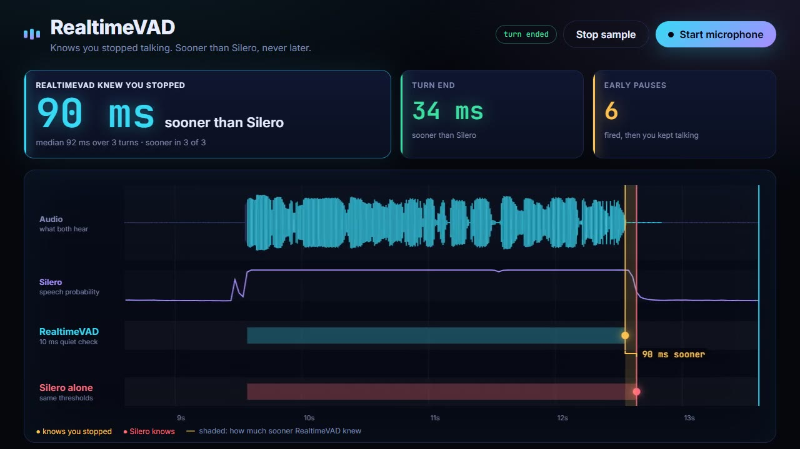

# RealtimeVAD

*Know that the speaker stopped, about 110 ms before Silero does.*

[RealtimeSTT](https://github.com/KoljaB/RealtimeSTT) · [RealtimeTTS](https://github.com/KoljaB/RealtimeTTS) · [Live demo](https://github.com/KoljaB/RealtimeVAD/blob/main/demo/README.md) · [Spec](https://github.com/KoljaB/RealtimeVAD/blob/main/SPEC.md)

A voice assistant can't do anything until it knows the user has stopped
talking. Speech recognition, the LLM call and the voice output all wait for
that one decision, and a normal voice activity detector takes a few hundred
milliseconds to make it.

RealtimeVAD makes it sooner. It keeps [Silero VAD](https://github.com/snakers4/silero-vad)
to decide what is speech, and adds a second, faster check: every 10 ms it
compares the audio level with the room's noise. The moment the audio goes
quiet, you get an event, long before Silero's probability has fallen.

- **Input:** 16 kHz mono audio in chunks of any size (float32, int16 or int16 bytes).
- **Output:** `start`, `pause` and `end` events, plus the audio of the running segment at any time.
- **Lead:** speech-off a median 110 ms before Silero's probability drops, and 214 ms before Silero's `VADIterator` reports the end, on 3,238 real turns.
- **Price:** it also fires in short gaps between words, about ten times as often as Silero.
- **Runs on:** one CPU thread, far faster than realtime. Needs only numpy and onnxruntime; the Silero model is bundled, no torch.
- **Status:** alpha (0.0.3). The API may still change.

## Quick start

```bash
pip install realtimevad
```

```python
from RealtimeVAD import VAD

vad = VAD()
for chunk in microphone_chunks():
    for event in vad.feed(chunk):
        if event.kind == "start":
            stream_to_asr(vad.audio())       # includes the audio just before speech began
        elif event.kind == "pause":
            speculate(vad.audio())           # the speaker may be done; this isn't the end yet
        elif event.kind == "end":
            finalize(event.segment.audio)
```

## Events

| Event | Meaning | When |
|---|---|---|
| `start` | Speech has begun | After about 64 ms of confident speech, so clicks don't trigger it |
| `pause` | The speaker may have stopped (speech-off) | Within about 10 ms of the audio going quiet |
| `end` | The segment is over | 0.24 s after speech-off, unless speech resumes. Never later than Silero alone |
| `onset` | Speech may have begun | At the first confident frame, before `start` confirms it. Off by default: `VAD(onset_events=True)` |

`vad.audio()` returns the running segment at any time, starting about 0.3 s
before the speech. `end` carries the finished segment with its audio, start
time, end time and the time the speech stopped.

If your assistant talks while the microphone is open, pass
`vad.feed(chunk, playback=True)` for those chunks so its own voice is handled
as possible echo. Every threshold and duration can be configured;
[SPEC.md](https://github.com/KoljaB/RealtimeVAD/blob/main/SPEC.md) lists what is guaranteed.

## How to use `pause`

`pause` is early and often wrong, on purpose. It fires on every breath, every
short gap between words and every stop consonant, so most `pause` events are
followed by more speech.

- **Use it to start work you can cancel:** finalize the transcript, call the
  LLM, prepare the voice output. Cancel when speech continues. A wrong `pause`
  then costs almost nothing, and a right one saves hundreds of milliseconds.
- **Never treat it as the end of the turn.** Only `end` closes a segment.
- **Can't cancel quickly?** Ignore `pause` and wait for `end`. The extra
  false alarms would cost you more than they save.

## Already using Silero?

Change the import:

```python
from silero_vad import load_silero_vad
from RealtimeVAD import VADIterator          # was: from silero_vad import VADIterator

vad_iterator = VADIterator(load_silero_vad(), sampling_rate=16000)
speech_dict = vad_iterator(chunk, return_seconds=True)   # {'start': ...} / {'end': ...} / None
```

The constructor and the results stay the same, but `end` arrives as soon as the
audio goes quiet. Without a model argument, it uses the bundled Silero model and
doesn't need torch.

## Results

Measured on 3,238 turns from a live voice assistant, each with its trailing
silence, with default settings. Silero's decisions are computed from the very
same frame probabilities, so both see identical input. "Speech-off" is
RealtimeVAD's last `pause` before the turn ended, against the first frame of
Silero's final run below its threshold.

| RealtimeVAD speech-off earlier than … | median | p25 – p75 | p90 | earlier in |
|---|---|---|---|---|
| Silero, probability below 0.5 (its default threshold) | 110 ms | 84 – 190 ms | 242 ms | 98 % |
| Silero, probability below 0.35 (`VADIterator`'s end threshold) | 120 ms | 98 – 200 ms | 252 ms | 98 % |
| Silero `VADIterator` end, default 100 ms minimum silence | 214 ms | 192 – 298 ms | 356 ms | 99 % |

| Speech-off signals followed by more speech | per second of speech | turns without any |
|---|---|---|
| RealtimeVAD `pause` | 1.6 | 16 % |
| Silero, probability below 0.5 | 0.15 | 85 % |

Reproduce with your own recordings (16 kHz mono WAVs, one turn each, with
trailing silence):

```bash
python benchmarks/speech_off_lead.py <wav dir> out.json
```

## Limits

- The numbers come from one speaker and one capture chain: browser capture
  with noise suppression and echo cancellation, mostly quiet rooms.
- The lead needs audio that actually goes quiet after a word, and noise
  suppression helps that. In the 147 noisier turns (room level above −70 dBFS)
  the median lead was 92–132 ms. Without noise suppression in a loud room,
  expect less.
- Earlier is not the same as correct: whether a speech-off sometimes lands
  inside a soft word ending was not checked against word timings.
- The lead is for speech-off, not for the turn end. `end` waits 0.24 s after
  speech-off in both cases; its own gain over Silero is smaller and depends on
  the noise.
- 16 kHz mono only.

## Live demo

[](https://github.com/KoljaB/RealtimeVAD/blob/main/demo/demo.mp4)

*[Watch the 13-second video](https://github.com/KoljaB/RealtimeVAD/blob/main/demo/demo.mp4) (with sound). It uses a synthetic voice and shows a median lead of 92 ms; the 110 ms above is the median on real voice-assistant turns.*

[demo/](https://github.com/KoljaB/RealtimeVAD/blob/main/demo/README.md) runs this page on your own microphone. It shows, turn by turn, how much sooner
RealtimeVAD knew that you stopped than Silero alone, on the same audio.

## Development

```bash
pip install -e ".[dev]"
pytest
```

## License and credits

MIT. The bundled speech model is [Silero VAD](https://github.com/snakers4/silero-vad) (MIT).
