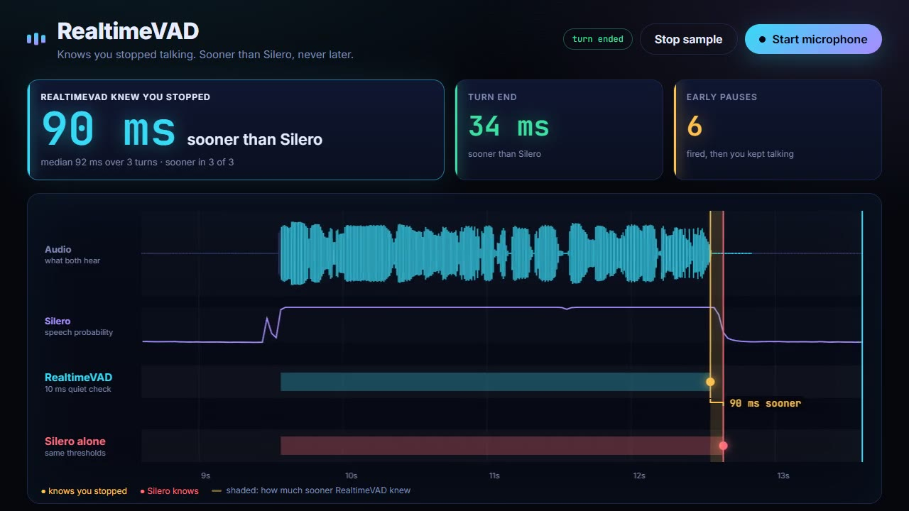

# RealtimeVAD live demo

[](demo.mp4)

*13 seconds, with sound: [demo.mp4](demo.mp4). The voice is synthetic: this clip shows a median lead of 92 ms, against 110 ms on real voice-assistant turns. The lead depends on the voice and on how each sentence ends.*

Speak into the microphone and stop. The page shows how much sooner RealtimeVAD
knew that you stopped than Silero alone, on the same audio.

- **The big number**: the lead for your last turn, then the median over all
  turns so far and in how many of them RealtimeVAD was sooner.
- **Turn end**: how much sooner RealtimeVAD closed the turn. It can only be
  sooner or the same, never later.
- **Early pauses**: pauses that fired while you kept talking. That is the price
  of reacting this early.
- **Timeline**: the audio, Silero's speech probability, and one row each for
  RealtimeVAD and Silero alone. A dot marks where each one knows you stopped;
  the shaded band between the two dots is the time RealtimeVAD won.

"Silero alone" uses the same probabilities and thresholds without the 10 ms
quiet check: it knows at its first silent frame.

**Settings** (below the timeline) holds the rest:

- **Show every event**: onsets (a ring at the first confident frame, grey if it
  never became speech), every pause, the wait after speech-off, both turn ends,
  the quiet threshold and Silero's 0.45 line.
- **Pause after**: how long the audio must stay quiet before a pause counts
  (fewer pauses, later speech-off).
- **Speech-on**: how long and how surely Silero must hear speech before a start
  is confirmed (fewer false starts from clicks, later start; the audio still
  reaches back to the onset).

Add `?window=4` to the address to zoom the timeline to 4 seconds (default 8).

## Run

From the repository root, then open http://127.0.0.1:8200:

```bash
pip install -e . -r demo/requirements.txt
python demo/server.py
```

`--sample file.wav` (16 kHz mono) enables **Play sample**, which streams a
recording instead of the microphone.

The microphone is captured with the browser's noise suppression on, as a voice
assistant would: it makes the gaps after words actually quiet, which is what
the 10 ms clock reacts to. A recording with a lot of room noise shows a much
smaller lead.

## Files

| File | What it does |
|---|---|
| `server.py` | Feeds browser audio to RealtimeVAD and works out the Silero-alone decisions from the same frames |
| `static/` | The page: capture worklet, canvas timeline, tiles and turn cards |
| `demo.mp4`, `demo.jpg` | The recording above and its still |

All times on the page are stream time (seconds of audio sent), the same clock
the server stamps on every event.
